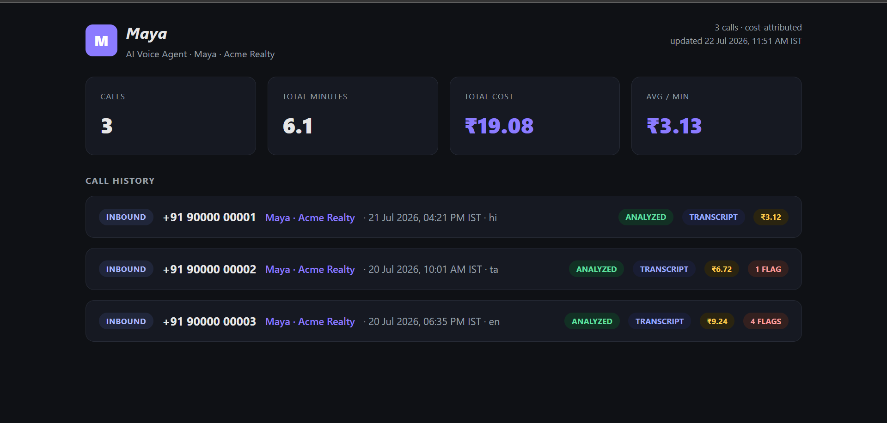
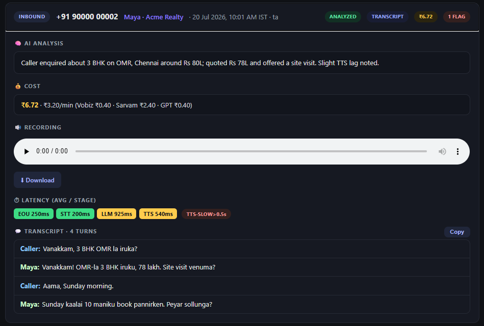
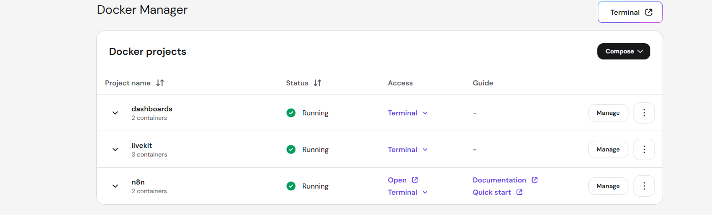
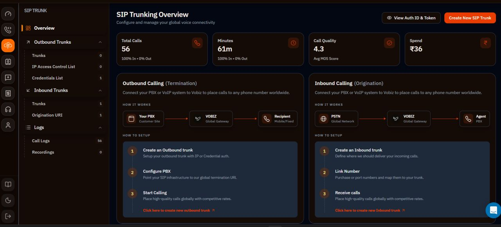
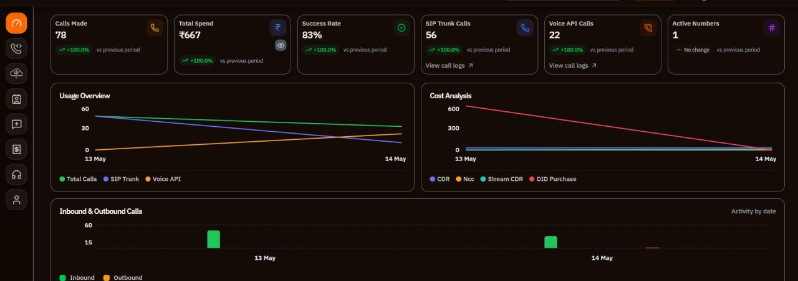

# 📞 voice-agent-starter-kit

[](https://github.com/purnasai1807-lgtm/ai_calling_assistant/actions/workflows/ci.yml)
[](LICENSE)

**A self-hosted, low-latency phone voice agent for Indian languages — that you can actually run on one cheap VPS.**

This kit shows you how to build a real inbound phone assistant that a customer
dials on a normal phone number, talks to in their own language, and gets useful
answers from — with **≈700 ms–1.2 s perceived turn latency**. It runs on
[LiveKit Agents](https://docs.livekit.io/agents/) with **Sarvam** for
Indian-language speech-to-text and text-to-speech, **OpenAI** for reasoning, and
**Vobiz** as the SIP telephony trunk. The whole thing fits on a single ~2 vCPU /
8 GB VPS.

The demo persona is **"Purna Sai"**, an inbound receptionist for a fictional
real-estate agency, **Purna Sai**. Purna Sai greets the caller, detects their
language (English + Hindi, Tamil, Telugu, Kannada, Malayalam), answers questions
about property listings, captures the caller's name / budget / preferred area,
and **books a site visit** — handing off to a human agent when asked. Swap the
persona and data and Purna Sai becomes a receptionist for *your* business.

> 💡 This is a sanitized, general-purpose starter kit distilled from a real
> production system. Everything here is fresh and safe to fork.

---

## ✨ What you get

- **A working inbound voice agent** — dial a number, talk to Purna Sai, get answers.
- **Real Indian-language support** — 8 kHz codemix STT + natural TTS via Sarvam,
  one language locked per call with a clean per-language agent hand-off.
- **Honest, measured low latency** — a tuned STT→LLM→TTS cascade, not marketing
  numbers (see [Latency](#-latency)).
- **SIP telephony wiring that actually connects** — the exact Vobiz → LiveKit
  inbound-trunk recipe, with every gotcha we hit documented loudly.
- **One-VPS deployment** — Docker, `systemd`, and Traefik (auto-HTTPS), with a
  copy-paste bootstrap.
- **An event ETL side-path** — an [n8n](https://n8n.io) workflow that logs calls,
  extracts structured lead data from transcripts, stores it in Supabase, and
  pings the owner on owner notification when a visit is booked.
- **A static call dashboard** — per-call latency breakdown, auto-flag chips, full
  transcript, and an inline recording player.

---

## 📸 Screenshots

### The call dashboard
Every call gets a card: cost, flags, an AI summary, per-provider cost split, the
recording, per-stage latency, and the full transcript.





> The dashboard above is the demo agent ("Purna Sai" for the fictional *Purna Sai*)
> generated by `python dashboard/build_dashboard.py --demo`. Numbers and callers are fake.

### Self-hosting on a VPS (Hostinger Docker Manager)
The whole stack runs as Docker projects on one VPS — `livekit` (server + redis + sip),
`n8n` (automations), and `dashboards`. See [`docs/02-vps-ssh-setup.md`](docs/02-vps-ssh-setup.md).



### Telephony (Vobiz SIP trunk)
Vobiz connects to LiveKit as a SIP trunk (inbound origination). Setup walkthrough in
[`docs/03-vobiz-sip.md`](docs/03-vobiz-sip.md).





---

## 🏗️ Architecture

```
                         ┌─────────────────── LIVE AUDIO PATH ───────────────────┐
                         │                                                        │
   ☎️  Caller            │                                                        │
      │ dials DID         │                                                        │
      â–¼                   â–¼                                                        â–¼
 ┌──────────┐      ┌──────────────┐      ┌───────────────────┐         ┌─────────────────────┐
 │  Vobiz   │─SIP─▶│ Vobiz inbound│─UDP─▶│     LiveKit       │─ job ──▶│   agent worker      │
 │   DID    │      │  SIP trunk   │ 5060 │  (cloud OR self-  │ dispatch│  (agent.py start)   │
 └──────────┘      │(Origination  │      │   hosted media)   │         │  AgentSession:      │
                   │    URI)      │      │ inbound trunk +   │         │  VAD→STT→LLM→TTS     │
                   └──────────────┘      │  dispatch rule    │         └──────────┬──────────┘
                                         └───────────────────┘                    │
                                                                     ┌────────────┼────────────┐
                                                                     â–¼            â–¼            â–¼
                                                              ┌───────────┐ ┌──────────┐ ┌──────────┐
                                                              │  Sarvam   │ │  OpenAI  │ │  Sarvam  │
                                                              │ Saaras STT│ │gpt-4.1-  │ │ Bulbul   │
                                                              │  (in)     │ │  mini    │ │ TTS (out)│
                                                              └───────────┘ └──────────┘ └──────────┘

                         └──────────────── EVENT / ETL SIDE-PATH (not live audio) ────────────────┐
                                                                                                   │
   agent emits events  ──▶  n8n webhook (POST /webhook/voice-events)  ──▶  Switch on event type    │
                                    │                                                              │
        call.started / call.completed ──▶ upsert Supabase `calls`                                  │
        transcript.ready ──▶ gpt-4o-mini JSON extract ──▶ Supabase `site_visits` ──▶ owner notification DM   │
        recording webhook ──▶ recording_handler (SSRF-guarded) ──▶ /opt/voice-agent/recordings/    │
                                    │                                                              │
                                    ▼                                                              │
                    dashboard/build_dashboard.py  ──▶  static call dashboard (Traefik + HTTPS)     │
                                                                                                   ┘
```

**Live audio path** (must be fast): Caller → Vobiz DID → Vobiz SIP trunk →
LiveKit → agent worker → Sarvam/OpenAI and back.
**ETL side-path** (can be slow): the agent posts events to n8n, which logs to
Supabase, extracts leads, alerts owner notification, and feeds the dashboard.

---

## âš¡ Latency

These are **real measured numbers** on an India VPS with a tuned cascade — quoted
honestly, not idealized. Full reproduction recipe in
[`docs/04-latency.md`](docs/04-latency.md).

| Stage | Measured |
|---|---|
| End-of-utterance detection (EOU) | ~0.15–0.29 s |
| STT transcription delay | ~0.08–0.29 s |
| LLM time-to-first-token (gpt-4.1-mini) | ~0.5–0.8 s *(Groq Llama-3.3 ~0.32 s but weaker Indic)* |
| TTS time-to-first-byte (Sarvam Bulbul v3) | ~0.33–0.35 s |
| **Perceived turn latency** | **~700 ms – 1.2 s** |

> **The honest headline:** ~700 ms–1.2 s perceived turn latency on a self-hosted
> STT→LLM→TTS cascade, on one India VPS. **Sub-500 ms every turn is NOT achievable
> with a cascade** — only a speech-to-speech model gets you there. Measured, not
> guessed.

---

## 🧰 Tools you'll need

Set each of these up in [`docs/01-procurement.md`](docs/01-procurement.md).
Prices are illustrative in INR — **approx, verify current pricing (checked 2026-07)**.

| Tool | What it does | Illustrative cost |
|---|---|---|
| **Vobiz** | Phone number (DID) + inbound SIP trunk + call recording | ~₹500 number + ~₹1,000 wallet recharge |
| **Sarvam AI** | Indian-language STT (Saaras) + TTS (Bulbul) | ~₹1,000 credits |
| **OpenAI** | The reasoning LLM (`gpt-4.1-mini`) | a few $ credit (cheap) |
| **LiveKit** | Realtime media server + SIP (Cloud free tier *or* self-host) | free tier / self-host |
| **Hostinger VPS** | The one box that runs everything (Ubuntu 22.04, KVM 2) | ~₹2,500/mo |
| **Supabase** *(optional)* | Postgres for call logs + booked visits | free tier |
| **owner notification** *(optional)* | DM the owner when a site visit is booked | free |

**Total to your first call:** roughly **₹5,000 one-time-ish + usage**. Your
mileage varies — verify each price at signup.

---

## 🚀 Quickstart

Work through the docs in this order. Each one is a self-contained, copy-paste guide.

1. **[Procurement →](docs/01-procurement.md)** — create every account and collect
   your credentials (Vobiz, Sarvam, OpenAI, LiveKit, Hostinger).
2. **[VPS & SSH setup →](docs/02-vps-ssh-setup.md)** — stand up the Ubuntu box,
   lock down the firewall, install Docker + Python, and clone the repo.
3. **Deploy the agent** — configure `.env`, install deps, run the worker:
   ```bash
   git clone https://github.com/purnasai1807-lgtm/ai_calling_assistant.git /opt/voice-agent
   cd /opt/voice-agent
   cp .env.example .env          # then fill in your real values
   python3.11 -m venv .venv && source .venv/bin/activate
   pip install -r requirements.txt
   python agent.py start         # registers the worker with LiveKit
   ```
   (For production, run it under `systemd` — see the deploy guide.)
4. **[Vobiz SIP wiring →](docs/03-vobiz-sip.md)** — point Vobiz's Origination URI
   at LiveKit, create the no-auth inbound trunk + dispatch rule.
5. **[n8n ETL →](docs/03-vobiz-sip.md)** *(and the n8n workflow in [`n8n/`](n8n/))* —
   import the workflow, wire Supabase + owner notification, enable the recording handler.
6. **Make your first call** — dial your Vobiz DID and say hello to Purna Sai. 🎉

> New to the whole flow? Read [`docs/04-latency.md`](docs/04-latency.md) once your
> agent answers, so you know how to keep it fast.

---

## 🗂️ Repo layout

```
voice-agent-starter-kit/
├── README.md                 ← you are here
├── LICENSE                   ← MIT
├── .env.example              ← canonical env file — copy to .env
├── .gitignore
├── requirements.txt          ← Python dependencies
├── agent.py                  ← the LiveKit worker + AgentSession + entrypoint
├── prompts.py                ← Purna Sai's persona + per-language system prompts
├── tools.py                  ← function tools (lookup properties, book visit, transfer, set_language)
├── config.py                 ← loads + validates all env vars
├── data/
│   └── properties.json       ← sample Purna Sai listings (read via a tool, never in the prompt)
├── deploy/
│   ├── vps_setup.sh          ← one-shot VPS bootstrap (Docker, Python, firewall)
│   ├── create_sip_trunk.py   ← creates the LiveKit inbound trunk + dispatch rule
│   ├── docker-compose.livekit.yml  ← self-hosted LiveKit + SIP + redis (optional path)
│   ├── livekit.yaml.example  ← config for self-hosted LiveKit
│   └── voice-agent.service   ← systemd unit for the worker
├── n8n/
│   ├── workflow.voice-events.json  ← the event ETL workflow (import into n8n)
│   └── docker-compose.n8n.yml      ← self-hosted n8n (+ Traefik)
├── grammar/                 ← per-language "sound native" sheets (loaded per call)
│   ├── purna_sai_en_grammar.md    ← honorifics, code-mix rules, real-estate vocab, §5b fixes
│   ├── purna_sai_hi_grammar.md    ← Hindi · purna_sai_ta/te/kn/ml_grammar.md for the rest
│   └── README.md             ← how the sheets load + the self-learning loop
├── dashboard/
│   ├── build_dashboard.py    ← regenerates the static call dashboard (inline templates)
│   └── README.md
└── docs/
    ├── 01-procurement.md     ← buy the number, keys, VPS (with costs)
    ├── 02-vps-ssh-setup.md   ← SSH from zero, firewall, Docker
    ├── 03-vobiz-sip.md       ← Vobiz SIP trunk wiring + every gotcha
    ├── 04-latency.md         ← the ~700ms–1.2s numbers + tuning recipe
    ├── 05-add-a-client.md    ← clone Purna Sai for your own business
    └── 06-cost-per-minute.md ← proof it runs under ₹5.5/min (≈₹3.15 tuned base)
```

---

## 🎨 Customizing for your own use case

Purna Sai voice agent is just a demo. To point the same machinery at *your*
business — a restaurant, a gym, a support desk — you only touch three places
(full walkthrough in [`docs/05-add-a-client.md`](docs/05-add-a-client.md)):

1. **`prompts.py`** — rewrite Purna Sai's persona, tone, and what she's allowed to do.
   Keep the system prompt **short** (≤2 kB) — it's the biggest latency lever.
2. **`data/*.json`** — replace `properties.json` with your own data (menu,
   services, availability). The agent reads it through a function tool, so it
   never bloats the prompt.
3. **`tools.py`** — adjust the function tools to your domain (e.g. `book_visit` →
   `book_appointment`), and set `AGENT_NAME` + language defaults in `.env`.

Deploy the same way, dial your number, done.

---

## 🙏 Credits

Built on the excellent work of the
LiveKit, Sarvam, and n8n communities.

Licensed under the **MIT License** — see [`LICENSE`](LICENSE). Use it, fork it,
ship it.

